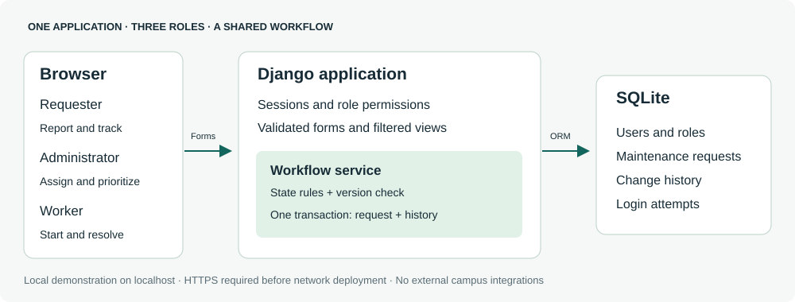
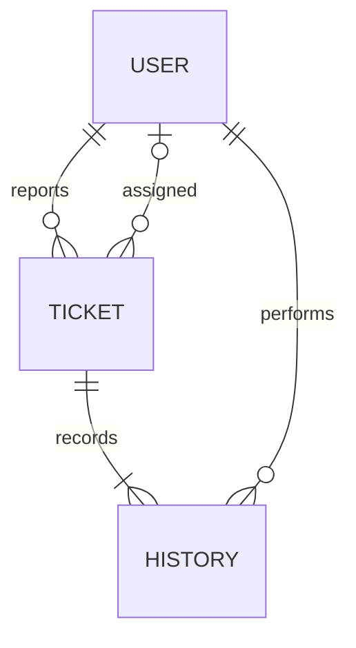
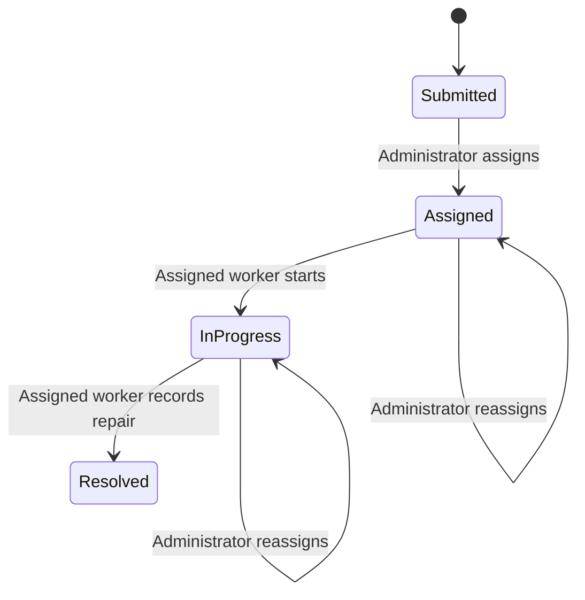

# Initial architecture

## Component responsibilities

| Component | Responsibility | Source |
|---|---|---|
| Browser/templates | Role-specific screens, labeled forms, feedback, filters | templates/ |
| Django views | Authenticate, bind forms, return responses | maintenance/views.py |
| Forms | Validate choices, lengths, worker selection and version | maintenance/forms.py |
| Workflow service | Authorize operations, enforce states, save history atomically | maintenance/services.py |
| Data models | Users, requests, history and login attempt records | maintenance/models.py |
| Session middleware | End idle authenticated sessions after 30 minutes | maintenance/middleware.py |
| SQLite | Persistent local storage with serialized write transactions | config/settings.py |

## Data relationships

A ticket has one requester and zero or one worker. Status, priority, worker, version and timestamps describe current state. Each change produces a history record containing its actor and old/new tracked values. No endpoint edits or deletes history. Database administrators remain outside this application-level trust boundary.

## State model

Priority may change only while unresolved. Reassignment immediately removes the previous worker's access. Resolved requests cannot reopen or change in this baseline.

## Permission boundary

The view checks access before returning record data; write services recheck authorization inside the transaction. A hidden button is never the security control. Requesters see their own requests, workers see their current assignments, and administrators see all. Unauthorized existing records return 403; nonexistent IDs return 404, matching the proposed SRS. This reveals record existence; opaque 404 responses for both are a possible future privacy improvement to discuss and document before changing the baseline.

## Integrity and concurrent updates

Forms carry the request version. The service rejects a stale version with 409. SQLite uses IMMEDIATE transactions to serialize writes; the update also includes a version condition. Request and history commit together. An injected history-write failure rolls back the request change. SQLite is suitable for this small local demo; real concurrency and load limits must be measured before selecting a production database.

## Deployment boundary

Default setup binds localhost and uses a generated local secret stored outside Git. Real passwords, databases, and session keys are not committed. Before any network deployment: configure `FIXTRACK_DEBUG=0`, a separate `FIXTRACK_SECRET_KEY`, allowed hosts, HTTPS termination, static-file serving, operational logging, backups, and deployment checks. Secure cookie and SSL redirect settings are enabled when debug is disabled. TLS is not provided by the development server.

Login throttling counts five failures per username or source IP over ten minutes. Proxy IP handling, attack-driven lockout risks, cleanup of old attempt rows, and authentication monitoring need review before public use. The demo does not trust forwarded IP headers.

## Decisions for feedback

- Is reopening required, or is resolved read-only sufficient?
- Should original report edits be allowed before assignment?
- Is a single-campus prototype enough for this course?
- Confirm quality targets and the production deployment scope before implementation expansion.

## Technical references

- Django transaction documentation: https://docs.djangoproject.com/en/5.2/topics/db/transactions/
- Django authentication documentation: https://docs.djangoproject.com/en/5.2/topics/auth/default/
- Django deployment checklist: https://docs.djangoproject.com/en/5.2/howto/deployment/checklist/
